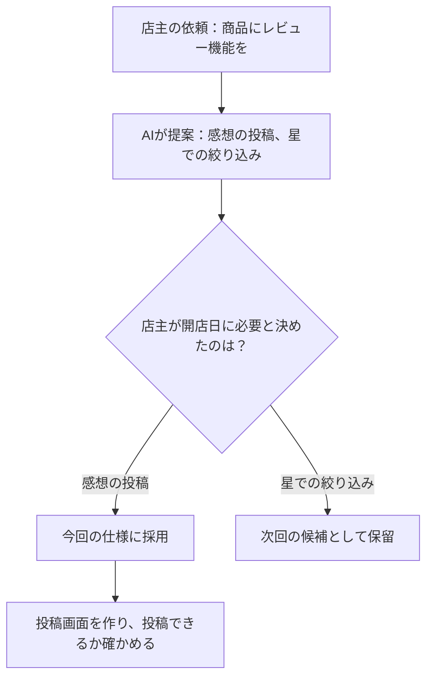
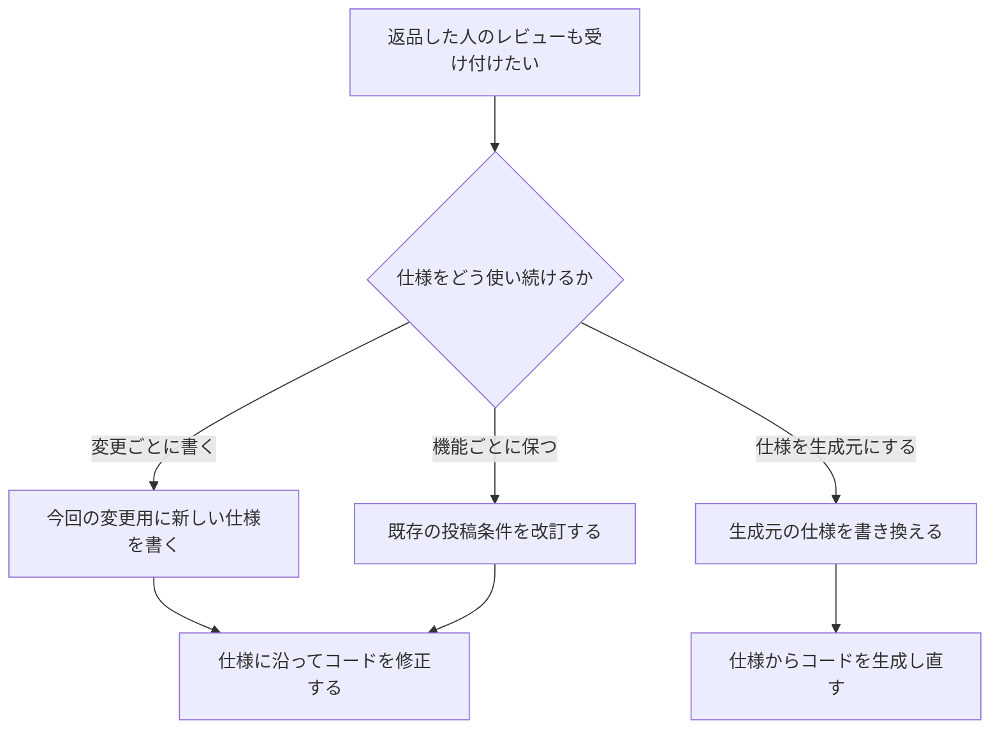

## 前提知識｜先に押さえたい言葉

| 言葉 | この記事での意味 |
| --- | --- |
| 要求 | 「お客さんが商品の感想を書けるようにしたい」など、利用者や作り手が実現したいこと。 |
| 仕様（Spec） | 「商品を受け取った人がレビューを投稿できる」など、どんな条件で何が起きるべきかを決めたもの。 |
| 仕様駆動開発（SDD） | 仕様を先に書き、それを手がかりに設計・実装・検証を進める開発方法。 |
| Kiro（キロ）／Spec Kit | AIと仕様駆動開発を進めるための道具。Kiroは開発環境、Spec Kitは開発手順を支えるツールキット。 |
| EARS（イアーズ） | 「いつ・どんなときに・何が起きるか」を読み取りやすくする、要求文の書き方。 |
| MDA（モデル駆動アーキテクチャ） | 業務の仕組みをモデルという設計図で表し、そこから特定の技術に合わせた実装を作る考え方。 |
| BDD（振る舞い駆動開発） | 利用者にとって望ましい動作を具体例で話し合い、その例を開発やテストに使う方法。 |

## 今日の問い

2025年7月、KiroというAI開発ツールの発表記事に、妙に気になる実演が載りました。舞台は工芸品の通販サイト。開発者の注文は「商品にレビュー機能を追加して」という一言です。するとKiroは、レビューを書く機能や読む機能に加えて、レビューを絞り込む機能まで盛り込んだ文書を作ります。コードを書くのは、このあとです。［1］

ここで引っかかります。**絞り込みを頼んだのは誰でしょう。** 買い物をする側からすれば、星一つの感想だけを読みたい日はあります。もっともな提案です。でも、この店にはまだレビューが一件もないかもしれない。最初の一人に感想を書いてもらうために、絞り込み画面まで今すぐ作る必要があるでしょうか。

この実演には「仕様駆動開発」という名前が付いています。仕様とは、製品がどんな条件でどう振る舞うべきかを書いたものです。開発者が仕様書を読んでプログラムを書くのは、昔からある仕事です。では今回の何が新しいのか。AIがコードを書けること？　そのAIに、先に長い仕様書を書かせること？　そもそもAIが提案しただけの「絞り込み」は、いつ店の仕様になったのでしょう。

この問いに答える手掛かりが、Kiroの発表文の中に一つあります。仕様を書く際に使う **EARS** という見慣れない名前です。出典をさかのぼると、通販サイトからずいぶん遠い場所に着きます。ジェットエンジンの制御装置です。［1・2］

## ジェットエンジンの設計者は、なぜ英語の語順を気にしたのか

2009年、アリステア・メイヴィンらは、航空機エンジンの制御システムに適用される規則を読み、装置が満たすべき要求を取り出す仕事について報告しました。元になるのは人間が読む文章です。そこから、装置を作る人と、出来上がった装置を検査する人が同じ意味に読める要求を取り出す。文章を読んで要点をまとめる作業に見えますが、厄介なのは、要点を落とした側にも立派な文章が書けてしまうことでした。［2］

たとえば「必要に応じて利用者に知らせる」。文章としては自然です。ところが作る側から見ると、誰が「必要」と判断するのか分かりません。検査する側はもっと困ります。通知が一度も出なかったとき、故障なのか、必要な状況が一度もなかったのか区別できません。これは説明用の例ですが、原論文が挙げた問題にも、曖昧さ、複雑さ、具体性の不足が含まれています。［2］

だったら厳密な記号で全部書けばいい、という案も考えられます。著者たちはそこで別の費用を見ています。元の要求はすでに人間の言葉で書かれている。記号に翻訳すれば、その翻訳でも意味を取り違えます。新しい記法を現場の人に覚えてもらう時間も要ります。そこで彼らが選んだのは、普通の文章を残しながら、条件や出来事、システムの応答を書く順序に軽い制約をかけることでした。これがEARSです。原論文では五つの基本の型を示しています。［2］

通販サイトに持ち帰ると、効き目が分かります。「商品レビューを適切に表示する」を、「読者が星一つを選んだとき、その商品の星一つのレビューを表示する」と書き換える。すると、実装する前に聞けることが増えます。該当するレビューがゼロなら、画面は真っ白でいいのか。「まだありません」と出すのか。他の評価に戻る方法は残すのか。文章が整って気持ちいいから採用するのではなく、**どこから先をまだ決めていないかが見える**から、この型には価値があります。

ここで最初の仮説が一つ消えます。「AIが理解できるよう、人間が初めて仕様の書き方を工夫した」という説明は、年代が合いません。Kiroは2025年の発表でEARSを使うと明記しています。16年前に人間同士の読み違いを減らすために発表された技法を、AIとの開発にも採り入れたわけです。今回の話で、資料から直接たどれるつながりです。では残る候補は、「仕様を機械に読ませてコードを作ること」でしょうか。こちらにも先例があります。［1・2］

## 2001年の設計図には、すでにコードを生む役目があった

時計をもう少し戻します。2001年、技術標準を作る団体OMGが、MDA（モデル駆動アーキテクチャ）の開発手順を解説しました。当時の問いは、気に入った図の描き方を統一することではありませんでした。同じ業務を、異なる技術の上で何度も実現しなければならない。土台を乗り換えるたびに、業務の仕組みまで一から書き直すのか。そこに狙いを定めた提案でした。［3］

ここでいうモデルは、対象のうち設計に必要な事柄を選び、一定の記法で表したものです。例の店なら、「一つの商品には複数のレビューが付く」「各レビューには投稿者がいる」という関係は、サーバーの製品名を決める前から表現できます。MDAでは、こうした特定の実行環境に依存しないモデルから、採用した技術に合わせた具体的なモデルを作り、実装へ変換します。どこまで自動で変換できるかは、使える道具や、設計に書き込んだ情報に依存します。［3］

この古い資料の中でいちばん現代的なのは、むしろ**コードができたあとの話**です。実際に動かしてみて、プログラマーがコードのほうを調整したとする。その変更を元のモデルにも戻せるのか。OMGの解説には、この往復を実現したいが、初期の道具では十分に支えられないので、モデル側で直して作り直す必要がある、と書かれています。図からコードを生成できたところで、仕事は半分しか終わっていませんでした。［3］

この面倒は、今のレビュー機能にもあります。仕様には「すべてのレビューを表示する」とある。後日、削除済みの投稿が見える不具合が見つかり、急いでコードだけを修正する。その翌月、別の人が古い仕様をAIに渡して一覧画面を作り直したらどうなるか。AIが頼まれた通りに働くほど、消した投稿がまた現れかねません。設計を入力に使うなら、前回の修正をどちらに残したかがものを言います。

MDAを現在のAIツールの直接の祖先と呼ぶ根拠は、ここで読んだ資料にはありません。両者から確かに言えるのは、機械が設計を読んで実装の一部を作る発想も、手直しのあとで設計とコードが食い違う問題も、生成AIより前にあったことです。すると疑問はだいぶ絞れます。昔の道具も設計からコードを作れたのに、Kiroはなぜ、わざわざ最初に人間の一言を膨らませるのでしょう。

## AIが引き受けたのは、コードを書く一歩手前だった

もう一度、Kiroの実演を順番に読んでみます。最初の「商品にレビュー機能を」という注文を受けて、AIがまず作るのは、どんな人が何をできるようにするかと、何が起きればその機能を完成と認めるかを書いた文書です。次に、了承された要求と既存のコードを照らして設計を作る。それから作業を細かく分け、どの作業がどの要求を満たすのかを結びます。開発者は途中の文書を読めます。［1］

MDAの白書が詳しく解説したのは、すでに一定の記法で表現された設計から、その先をどう作るかでした。Kiroの実演で目を引くのは、その設計を書くよりも手前です。「レビュー機能」という日常語から、星で絞る画面まで提案する。二つをたどると、今回変わった部分が見えます。人が入力した言葉にはなかった判断を、道具のほうが案として持ち込める。その判断を読む機会が、コードを書く前に設けられています。［1・3］

仮に、店の依頼をそのままAIに渡し、一気に実装してもらったとします。完成した画面に星の絞り込みが付いていれば、店主は気づくでしょう。一方、「自分で書いたレビューを自分で評価できるか」という判断は、画面を眺めただけでは分かりません。誰かが実際にその操作をするまで、店主が決めていないルールが動き続けます。コードを先に作る方法でも、人は後から調べて直せます。ただし、何を決められてしまったかを、動作やコードから逆向きに探すことになります。

先に仕様を出すと、同じ店主が「うちで欲しいのは、買った人が感想をひと言残せること。評価の絞り込みはまだ要らない」と、画面が一枚もない時点で言えます。実際に価値があったのは、AIが依頼の裏側を正確に読み取ったことなのでしょうか。この例では、むしろ一度読み違えてくれたおかげで、店主が注文の範囲をはっきりさせられました。AIの提案を仕様と呼べるのは、人がその振る舞いでよいと判断してからです。

**「レビュー機能が欲しい」から、どこまで作るかが決まるまで。** Kiroの実演を出発点に、店主が絞り込みを見送った場合を図にすると、分かれ目はここです。

同じ2025年、GitHubはSpec Kitの発表記事で、AIがもっともらしいコードを返しても依頼者の意図から外れる問題を取り上げています。そこで示したのが、欲しい振る舞いを記述し、実装の計画を立て、個々の作業に分けて進める手順です。一度の会話で済ませていた判断を文書に残すと、次の工程でも読み返せます。Kiroとは別の製品が、似た困り事に対して、ここを開発の出発点に選んでいます。［4］

## それなら、テストに合格した時点で「意図通り」と言えるか

ここまでの説明には、まだ穴があります。仕様を書いた本人にも、書き漏らしはあります。レビューを投稿できるのは購入者だけ、と店主が決めたとしましょう。AIはそれを実装し、「購入した人は投稿できる」「買っていない人は投稿できない」という二つのテストにも合格しました。このとき、本当に店主の意図がコードに伝わったと言えるでしょうか。

一人、お客さんを呼んでみます。「注文して、届く前にキャンセルしたんですが、レビューを書けました」。おかしな動作に見えます。でも、注文履歴がある人を「購入者」と決めたならプログラムはその通りに動いています。商品を受け取った人を指すなら、この動作は誤りです。二つのテストはどちらの解釈でも合格します。違いが現れるお客さんを、一人も登場させていなかったからです。

| レビューを書こうとした人 | 注文履歴があれば書ける仕様 | 商品を受け取ったら書ける仕様 |
| --- | --- | --- |
| 商品が届いた人 | 書ける | 書ける |
| 一度も注文していない人 | 書けない | 書けない |
| **注文して、届く前にキャンセルした人** | **書ける** | **書けない** |

人が合意できる具体例を出して、期待する動作を書く。この工夫にもAI以前の歴史があります。2000年代初めに生まれた**振る舞い駆動開発（BDD）**では、何からテストすればよいのかという開発者の悩みから、利用者にとって意味のある振る舞いを言葉にする方法が発展しました。「こういう前提で、こんな操作をすると、この結果になる」と例を書き、プログラムに結び付けることで、繰り返し実行して確かめられます。Cucumberプロジェクトが、その経緯を記録しています。［5］

店主に見せるなら、百行のコードより「商品を受け取る前に注文をキャンセルした人が、投稿ボタンを押したらどうしますか」の一行のほうが答えやすいでしょう。ここで「受け取った人に感想を書いてほしい」と初めて聞けたら、テストを一つ増やすだけでは足りません。「購入者」という元の言葉も直す必要があります。次にその言葉を読む開発者には、今日の会話が聞こえないからです。

逆に、何もかもを実装前に聞けばよいわけでもありません。返品した人の感想を載せるかまで考えると、「届いた商品に問題があったからこそ、感想を残してほしい」と店主が言うかもしれない。その判断は、実際のお客さんの声を読んでから変わってもおかしくありません。1986年の論文で、デイヴィッド・パーナスとポール・クレメンツは、依頼者も欲しいもののすべてを最初から語れるとは限らず、実装中に知った事実が以前の設計を覆す、と指摘しました。だからこそ、後から読む人が判断をたどれる形に文書を整える意味がある。約40年後、後から読む側には、次の変更を任されたAIも加わりました。［6］

## 「仕様駆動かどうか」は、二度目の変更で見えてくる

では、仕様から作業を始めて意図のずれを確かめれば、翌月もその仕様を維持するのが当然でしょうか。ここは、ツールの紹介を一つ読んだだけでは判断を誤りやすいところです。2025年10月、エンジニアのビルギッタ・ベッケラーが、仕様駆動をうたう三つのツールを実際に調べました。彼女が区別したのは、仕様を**いつまで使うつもりなのか**です。これは彼女の観察による整理で、全製品が従う公式の定義ではありません。［7］

一つ目は、今回の変更のために仕様を先に書く使い方です。レビュー機能の初回リリースが終われば、その文書は当時の記録として役割を終えます。翌月に返品者の扱いを変えるなら、新しい変更の仕様を書きます。古い文書が残っていても、それを読むだけで現在の挙動がすべて分かると期待するのは無理があります。

二つ目は、同じ仕様を保守し続ける使い方です。「誰がレビューを書けるか」は機能がある限り一つの場所で更新します。新しく担当する人には便利です。その代わり、深夜にコードだけを急いで直した日にも、翌朝には誰かが仕様との食い違いを見つけて整える仕事が残ります。ファイルを保存しておくだけでは、その仕事を引き受けたことになりません。

三つ目が、仕様そのものを、人が編集する主なソースとして扱う使い方です。ソースとは、そこからプログラムを作る元の記述という意味です。人は仕様を直し、コードはそれをもとに生成し直します。この運用なら、たとえコードを一行直せば済む場合でも、その一行を直接直すと次の生成で失うかもしれません。先ほどのMDAの白書を読んでおくと、この約束がなぜ必要なのか、そしてなぜ守るのが大変なのかが分かります。［3・7］

**翌月、店主が「返品した人も書けるようにして」と頼んだら。** 同じ依頼でも、次の担当者が開くファイルと、コードを更新する経路が変わります。［7］

冒頭の通販サイトが完成した日の画面を見ても、この三つは区別できません。どの方法でも、同じ星形のボタンを表示できます。違いが表に出るのは、店主が二度目の注文を持ってきたときです。「返品した人も書けるようにして」。そのとき人が最初に開くのは、現在の仕様か、新しい依頼を書くファイルか、それともコードか。この一問なら、「うちも仕様駆動です」と言う二つのチームが、実はずいぶん違う仕事をしていることにも気づけます。

## 絞り込みを頼んだのは、結局誰だったのか

Kiroの発表記事を読み返すと、確かめられるのは、短い依頼からKiroが絞り込みを**提案した**ところまでです。これが工芸品の店にとって必要だったかは、あの一言からは決まりません。AIが整った仕様書を出力した瞬間を「要求が決まった瞬間」と取り違えると、頼んだ覚えのない画面にも設計とテストが付き、時間をかけて正確に完成してしまいます。［1］

だから「今の開発は仕様駆動開発というの？」への答えは、こうなります。**AIと一緒に作る開発のうち、欲しい振る舞いを先に共有し、その記述をAIと人が設計・実装・検証に使う進め方が、仕様駆動開発と呼ばれています。** 名前だけでは、仕様をいつまで保守するかまでは分かりません。言葉を整えて誤読を減らす工夫も、設計を機械に渡す発想も、例をテストとして残す方法も、もっと前からありました。今回とくに面白いのは、短い注文を読んだ機械自身が「こんな機能も要りますか」と案を広げ、その答えを使って実物まで作れるようになったことです。［1–5・7］

もしこの店が明日開店なら、店主にまず一つだけ見せたいものがあります。完成予想図でも、AIが考えた機能一覧でもありません。仕様の「星一つのレビューだけを絞り込める」という一行です。これを指して「最初の一人が感想を書けるようにするのに、これは明日要りますか」と聞く。店主が「来月でいい」と答えたら、画面も、コードも、テストも一つずつ作らずに済みます。仕様が開発を動かした最初の証拠は、追加した機能と同じくらい、**作る前に取り消せた機能**にも残ります。

## 参考資料

1. Kiro開発チーム（2025年7月）[Introducing Kiro](https://kiro.dev/blog/introducing-kiro/)。「商品にレビュー機能を追加する」という実演、EARSの採用、要求を確認して設計に進む手順。
2. Alistair Mavinほか（2009年）[Easy Approach to Requirements Syntax (EARS)](https://research.manchester.ac.uk/en/publications/easy-approach-to-requirements-syntax-ears/)。原論文の書誌と要旨。型の例と成立経緯は[考案者自身の解説](https://alistairmavin.com/ears/)も参照。
3. Jon Siegel・OMG Staff Strategy Group（2001年）[Developing in OMG’s Model-Driven Architecture](https://www.omg.org/mda/mda_files/developing_in_omg.htm)。とくに「Round Trip Engineering」に、コードを直した後でモデルに反映する課題が記されている。
4. Den Delimarsky・GitHub（2025年9月）[Spec-driven development with AI](https://github.blog/ai-and-ml/generative-ai/spec-driven-development-with-ai-get-started-with-a-new-open-source-toolkit/)。Spec Kitを公開したときの問題意識と開発手順。
5. Cucumberプロジェクト [History of BDD](https://cucumber.io/docs/bdd/history/)。具体的なシナリオを検証に使う方法の成立と、初期の開発者の記録。
6. David L. Parnas・Paul C. Clements（1986年）[A Rational Design Process: How and Why to Fake It](https://doi.org/10.1109/TSE.1986.6312940)。第II節に、初期要求だけで設計を進めきれない理由が挙げられている。
7. Birgitta Böckeler（2025年10月）[Understanding Spec-Driven-Development: Kiro, spec-kit, and Tessl](https://martinfowler.com/articles/exploring-gen-ai/sdd-3-tools.html)。当時の製品を試した著者による、仕様の寿命と編集対象の区別。

関連して読んだ記事：おなさい「[自動プログラミングと仕様駆動開発　失敗の歴史](https://zenn.dev/netetahito/articles/79e03d10277b7b)」。生成した仕様を後から直すときに何が起きるかを、より長い自動化の歴史から考える記事。

執筆：ChatGPT（使用モデル：GPT-6）
